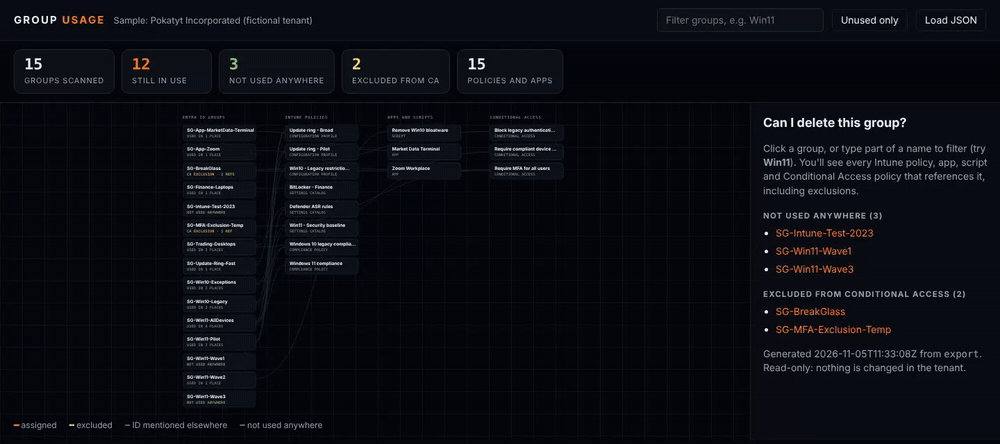
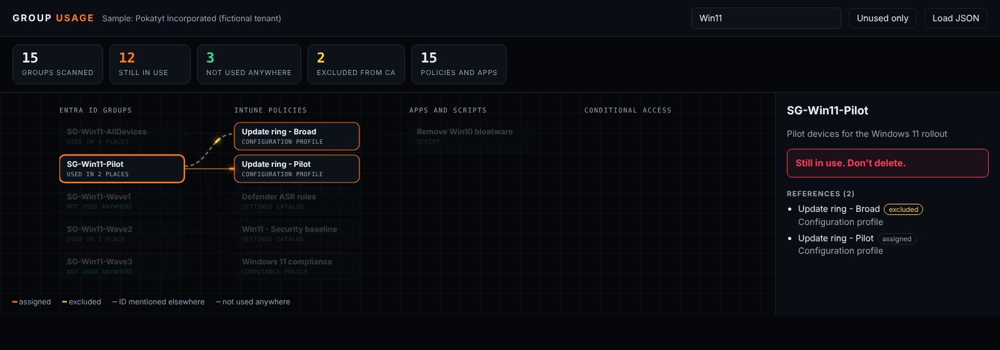

# intune-as-code: Intune and Entra ID configuration in Git

Export your Intune and Entra ID configuration to Git, catch changes made outside Git, and find out which groups you can safely delete.

**Live demo of the group usage report:** https://dzatsepin.github.io/intune-as-code/



The demo runs on **Pokatyt Incorporated**, a fictional tenant. All groups, policies and IDs in `samples/` are made up.

---

## Problem

Three things go wrong in almost every Microsoft 365 tenant that is managed through the portals.

1. **Nobody knows what changed.** A setting is changed in the Intune portal on a Friday afternoon. There is an audit log entry, but no review, no reason and no easy way back.
2. **Configuration can't be evidenced.** Auditors and due diligence questionnaires ask for the current baseline and its change history. Screenshots of the portal are not evidence.
3. **Temporary groups become permanent.** A Windows 11 rollout needs a migration group, pilot groups and wave groups. When the rollout is over they are still assigned to policies, apps and update rings, and one of them is probably excluded from something. Before you delete a group you need every reference to it, including exclusions. The portal doesn't show that in one place, so the groups stay for years, or one is deleted and a policy quietly starts applying to different devices or people.

## Approach

Treat the tenant configuration as code.

| Part | What it does |
|---|---|
| `src/Export-TenantConfig.ps1` | Read-only export through Microsoft Graph. One JSON file per object, properties sorted and volatile fields removed, so an unchanged tenant produces the same files and `git diff` shows only real changes |
| `templates/github-actions/drift-detection.yml` | Nightly job: export, compare with `main`, and open a **pull request** if something was changed in the portal. Approve it to accept the new baseline, or close it and revert the change |
| `src/Get-GroupUsage.ps1` | Offline analysis of the export: where every group is used (assignments, exclusions, Conditional Access, any other ID reference) and which groups are used nowhere |
| `report/index.html` | Visual report: pick a group and see what depends on it, with a clear verdict |

Exported today: groups, configuration profiles (including Windows update rings), settings catalog policies, administrative templates, compliance policies, scripts (metadata, not content), assigned apps and Conditional Access policies.

### Why a pull request and not just a backup

A backup tells you what the configuration was. A pull request forces a decision about every change, with a reviewer, a timestamp and a reason. That is change management you can show to an auditor, not a folder of JSON.

### How the group usage analysis works

For every group ID it looks for:

1. **Intune assignments:** `groupAssignmentTarget` (assigned) and `exclusionGroupAssignmentTarget` (excluded) on every exported object;
2. **Conditional Access:** `conditions.users.includeGroups` and `excludeGroups`;
3. **Anything else:** the group's object ID appearing anywhere else in an object (filters, settings, nested rules), reported as "mentioned".

A group with no references is reported as *not used anywhere*. A group excluded from a Conditional Access policy gets a warning, because deleting it changes who the policy applies to.

## Result

On the sample tenant:

```text
PS> ./src/Get-GroupUsage.ps1

15 groups · 12 in use · 3 unused · 2 excluded from Conditional Access

Group                      Status Refs Note
-----                      ------ ---- ----
SG-BreakGlass              in-use    2 CA exclusion
SG-MFA-Exclusion-Temp      in-use    1 CA exclusion
SG-Win11-Pilot             in-use    2
SG-Win11-Wave2             in-use    1
...
SG-Intune-Test-2023        unused    0
SG-Win11-Wave1             unused    0
SG-Win11-Wave3             unused    0
```

The rollout is finished, so which of its groups can go? The report answers per group:

| Group | Verdict | Why |
|---|---|---|
| `SG-Win11-Wave1`, `SG-Win11-Wave3` | Safe to delete | No assignment, exclusion or ID reference anywhere in the export |
| `SG-Win11-Wave2` | Don't delete yet | Looks finished, but a clean-up script is still assigned to it |
| `SG-Win11-AllDevices` | Replace first | The migration group is still the target of four policies. Delete it and most devices lose them |
| `SG-Win11-Pilot` | Don't delete yet | Excluded from the broad update ring. Delete it and the pilot devices fall under that ring |
| `SG-MFA-Exclusion-Temp` | Review | Meant to be temporary, still excluded from "Require MFA for all users". A security finding, not housekeeping |



"Can I delete this group?" becomes a lookup instead of an afternoon in the portal, and every later change to the configuration has a reviewed history.

## Retiring a temporary group safely

The sequence this repository is built around. Nothing is deleted until the last step.

1. **Export and inventory.** Export the configuration and list every reference to the group you want to retire.
2. **Replace, don't remove.** In each policy and app, swap the temporary group for the permanent ones (for example dynamic groups by device type) in the same change, so nothing is unassigned in between.
3. **Split a policy only when its settings differ.** If one device type needs different settings, it gets its own policy. If the settings are identical, add another assignment group. Two copies of the same policy will drift apart.
4. **Delete what is assigned to nothing.** Old policies with no assignments go first; they are the cheapest win.
5. **Export again, then delete.** Re-run the report. Delete the group only when it shows no references, and commit the export so the clean-up itself is on record.

## How to run

**Demo, no tenant needed** (PowerShell 7):

```powershell
git clone https://github.com/DZatsepin/intune-as-code.git
cd intune-as-code
./src/Get-GroupUsage.ps1                          # whole sample tenant
./src/Get-GroupUsage.ps1 -Group SG-Win11-Pilot    # one group
```

Then open `report/index.html` (or run `python -m http.server` and browse to `/report/`) and use **Load JSON** with `out/group-usage.json`. Type part of a name, for example `Win11`, to filter the groups.

**Your own tenant** (read-only):

```powershell
Install-Module Microsoft.Graph.Authentication -Scope CurrentUser
./src/Export-TenantConfig.ps1 -OutputPath ./export      # interactive sign-in, read-only scopes
./src/Get-GroupUsage.ps1 -ExportPath ./export -OutputPath ./out
```

Required Microsoft Graph permissions, all read-only: `Group.Read.All`, `DeviceManagementConfiguration.Read.All`, `DeviceManagementApps.Read.All`, `DeviceManagementManagedDevices.Read.All`, `Policy.Read.All`.

**Nightly drift detection:** copy `templates/github-actions/drift-detection.yml` and `src/` into a **private** repository. The template explains the app registration and the federated credential, so no client secret is stored anywhere.

**Tests:** `Invoke-Pester ./tests` (runs on every push in GitHub Actions, against the sample export).

## Security notes

- **Never commit a real export to a public repository.** A tenant export is a map of your security controls. Keep it in a private repository; `.gitignore` here excludes `export/` and `out/` to make accidents less likely.
- Everything is **read-only**. The scripts never change or delete anything in the tenant; deleting a group stays a human decision.
- In CI, use **workload identity federation** (OIDC) instead of client secrets.

## Status and scope

- `Get-GroupUsage.ps1`, the report and the tests run end to end on the sample export.
- `Export-TenantConfig.ps1` and the drift workflow follow the Microsoft Graph documentation and are being validated against a test tenant. Graph beta endpoints can change; issues and pull requests are welcome.
- Not covered yet: app protection policies, Entra ID role assignments, access packages, Teams and SharePoint membership, group-based licensing.

## Related tools

- [Microsoft365DSC](https://github.com/microsoft/Microsoft365DSC), [IntuneCD](https://github.com/almenscorner/IntuneCD) and [IntuneManagement](https://github.com/Micke-K/IntuneManagement) for broader backup and configuration management.
- [Microsoft Cloud Group Analyzer](https://github.com/jasperbaes/Microsoft-Cloud-Group-Analyzer) for live, per-group lookups across more services (check its licence terms for organisational use).

This repository is deliberately small: plain PowerShell, deterministic JSON, Git and a pull request. The goal is reviewed change management and safe clean-up, not a full configuration management platform.

## Repository structure

```
intune-as-code/
├── src/
│   ├── Export-TenantConfig.ps1   # read-only Graph export, deterministic JSON
│   └── Get-GroupUsage.ps1        # offline group usage analysis
├── report/
│   ├── index.html                # visual report
│   └── sample/group-usage.json   # output for the sample tenant
├── samples/export/               # fictional tenant export (Pokatyt Incorporated)
├── templates/github-actions/
│   └── drift-detection.yml       # nightly export and pull request on drift
├── tests/IntuneAsCode.Tests.ps1  # Pester tests
├── docs/                         # screenshots for this README
├── LICENSE
└── README.md
```

## Licence

MIT. See [LICENSE](LICENSE).
